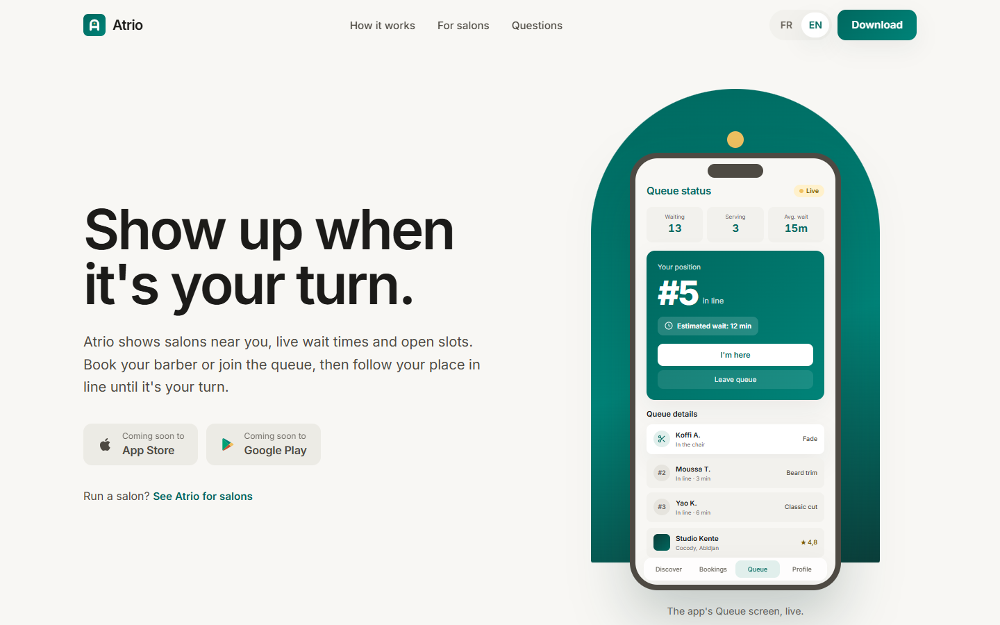
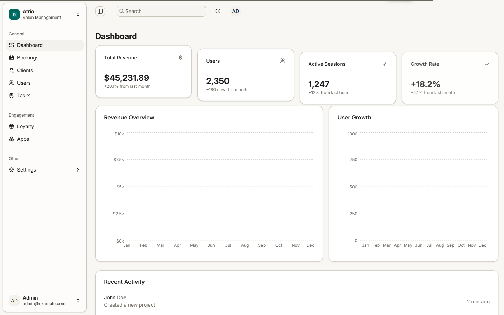
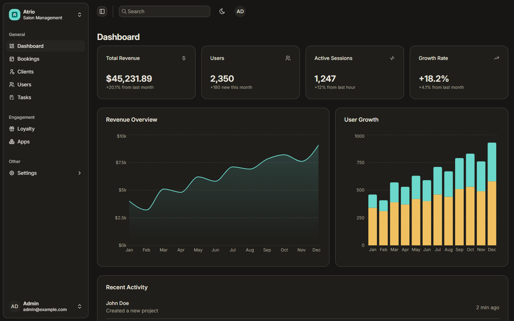
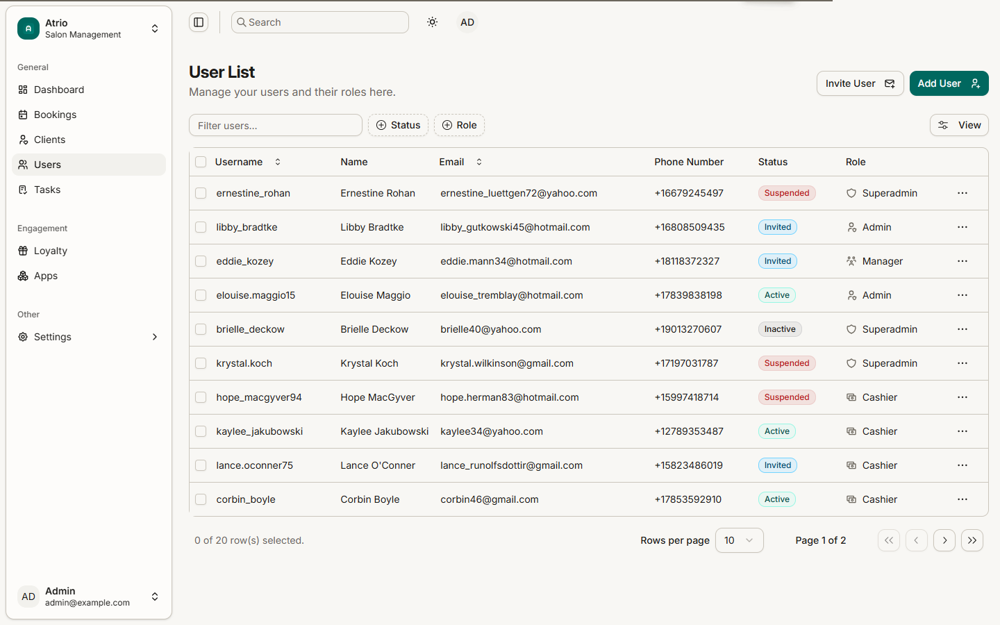
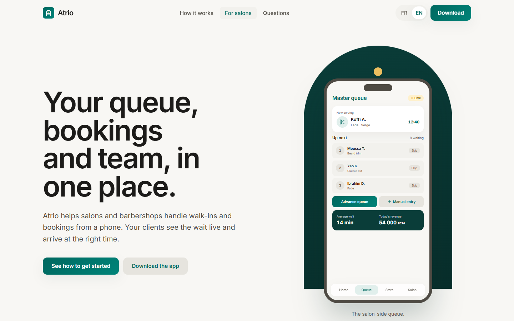
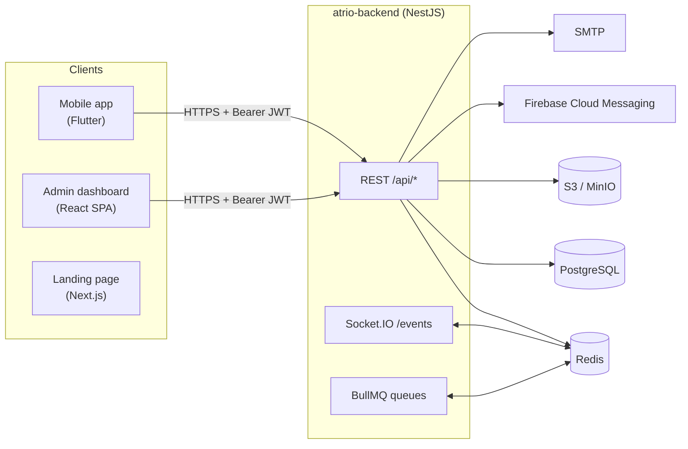

<div align="center">

# Atrio

**Salon and barbershop booking with a live queue. Clients and owners use one mobile app, platform staff use an admin dashboard, and everything sits on a NestJS API.**


</div>



---

## What is Atrio?

Walk-in salons and barbershops often keep their queue on paper or in their heads. Clients wait without knowing how long it will take. Atrio puts that queue online:

- **Clients** find salons nearby, see live wait times and open slots, book a barber or join the queue, then follow their position until it is their turn.
- **Salon owners and managers** run the queue, bookings, team (barbers), services and salon settings from their phone, with revenue and booking stats.
- **Platform staff** use a web admin dashboard to oversee users, bookings, clients and the loyalty program.

The apps are bilingual (French and English). The landing page defaults to French.

> **Project status:** in active development. The backend API is functional. The mobile app and admin dashboard UIs are built, but most of their screens still run on **mock data** and are not yet wired to the API. See [Known limitations](#known-limitations).

## Monorepo at a glance

| Project | Path | What it is | Stack |
| --- | --- | --- | --- |
| **Mobile app** | [`atrio-mobile-app/`](atrio-mobile-app/) | iOS/Android app for clients and salon owners (role-based) | Flutter, Riverpod, GoRouter, Dio, Drift, Freezed |
| **Admin dashboard** | [`atrio-dashboard-admin/`](atrio-dashboard-admin/) | Web back-office for platform staff | React 19, Vite 6, TanStack Router/Query/Table, Tailwind v4, shadcn/ui |
| **Backend API** | [`atrio-backend/`](atrio-backend/) | REST + WebSocket API | NestJS 11, TypeORM, PostgreSQL 16, Redis, BullMQ, Socket.IO |
| **Landing page** | [`atrio-landing-page/`](atrio-landing-page/) | Public marketing site (FR/EN) | Next.js 16, next-intl, Tailwind v4, Framer Motion |

Each project is independent and has its own package manager, dependencies and README. There is no shared workspace tooling at the root.

## Screenshots

### Admin dashboard

| Overview (light) | Overview (dark) |
| --- | --- |
|  |  |



### Landing page



> Screenshots were captured from the apps running locally. Dashboard figures are mock data. The phone screens on the landing page are coded recreations of the mobile app's flows, built with illustrative sample data.

## Key features

**Mobile app** ([details](atrio-mobile-app/README.md))
- Role-based navigation: a **client** shell (Discover · Bookings · Queue · Settings) and an **owner** shell (Dashboard · Bookings · Statistics · Settings)
- Salon discovery with search, filters, ratings and reviews
- Multi-step booking flow (service → barber → time slot → confirmation)
- Live queue position for clients, plus queue management for owners
- Owner tools: barber and service CRUD, salon settings, revenue statistics
- Loyalty (points, rewards, referrals), in-app chat, notifications, favorites
- Auth: email/password, phone + OTP, role selection, profile setup, onboarding
- Offline-first sync engine on Drift/SQLite with a sync queue, retries and conflict handling ([design doc](atrio-mobile-app/docs/offline_sync.md))
- Light/dark themes and English/French localization

**Admin dashboard** ([details](atrio-dashboard-admin/README.md))
- Overview with KPI cards and revenue/user-growth charts (Recharts)
- Users and tasks data tables with faceted filters, sorting and pagination
- Bookings, clients and loyalty sections (KPI cards + empty states for now)
- Settings: profile, security, notifications, preferences
- Command palette (`Ctrl/⌘ + K`), collapsible sidebar, light/dark/system theme, EN/FR
- Security hardening: route guards, in-memory tokens, JWT-expiry check, 15-minute idle timeout, safe-redirect validation, HTTPS enforcement in production, CSP and security headers in nginx

**Backend API** ([details](atrio-backend/README.md) · [endpoint reference](docs/API.md))
- JWT auth with access (15 min) and refresh (7 days) tokens
- Five roles: `SUPER_ADMIN`, `ADMIN`, `MANAGER`, `CASHIER`, `CLIENT`, enforced by a global auth guard plus a `@Roles()` guard
- Modules for salons, services, barbers, bookings, reviews and an immutable audit log
- Swagger/OpenAPI at `/api/docs`, Helmet, CORS allow-list, global validation, rate limiting
- Infrastructure: Redis, BullMQ queues, Socket.IO gateway (`/events` namespace), S3-compatible storage (MinIO locally), Firebase push, Handlebars email templates

**Landing page** ([details](atrio-landing-page/README.md))
- Client page, "For salons" page and privacy notice, in French (default) and English
- SEO metadata, sitemap and JSON-LD

## Architecture



- **Mobile** follows Clean Architecture per feature (`domain` / `data` / `presentation`). Data flows `Page → Notifier → UseCase → Repository → DataSource`, and errors come back as `Either<Failure, T>`.
- **Dashboard** is a client-rendered SPA with file-based routing (TanStack Router), server state in TanStack Query and auth in an in-memory Zustand store.
- **Backend** is a modular NestJS monolith. Each domain module (`salons`, `bookings`, …) has its own controller, service, DTOs and TypeORM entities on a shared `BaseEntity` (UUID primary key + timestamps). The Socket.IO gateway is in place for real-time features, but no client subscribes to it yet.
- **Landing page** is independent of the API. It is a static/SSR marketing site.

Read **[docs/ARCHITECTURE.md](docs/ARCHITECTURE.md)** for the full breakdown, including the auth model, role matrix and design system.

## Repository structure

```
Atrio/
├── atrio-mobile-app/        # Flutter app (client + owner roles)
│   ├── lib/core/            # network, router, theme, sync engine, database, widgets
│   ├── lib/features/        # auth, booking, salon, queue, loyalty, owner, chat, …
│   ├── test/ integration_test/
│   └── docs/offline_sync.md
├── atrio-dashboard-admin/   # React admin SPA
│   ├── src/routes/          # file-based routes (_authenticated, (auth), (errors))
│   ├── src/features/        # dashboard, users, bookings, clients, loyalty, settings, …
│   ├── Dockerfile nginx.conf vercel.json
├── atrio-backend/           # NestJS API
│   ├── src/common/          # config, database, guards, redis, storage, websockets, mail
│   ├── src/modules/         # auth, users, salons, services, barbers, bookings, reviews, audit-log, health
│   ├── templates/           # Handlebars email templates
│   ├── docker-compose.yml Dockerfile
├── atrio-landing-page/      # Next.js marketing site
│   ├── app/                 # [locale] routes, sections, coded app screens
│   └── messages/            # fr.json, en.json
├── docs/                    # cross-project documentation and screenshots
└── CLAUDE.md                # contributor/AI guidance: conventions, design + security rules
```

## Getting started

### Prerequisites

| Tool | Version | Needed for |
| --- | --- | --- |
| Node.js | 20+ | dashboard, backend, landing page |
| pnpm | 9+ | dashboard |
| Yarn | 1.x | backend |
| npm | bundled with Node | landing page |
| Docker + Docker Compose | recent | backend infrastructure (Postgres, Redis, MinIO) |
| Flutter SDK | stable, Dart ≥ 3.6 | mobile app |
| Android Studio / Xcode | — | running the mobile app on an emulator or device |

```bash
git clone https://github.com/Yobson2/Atrio.git
cd Atrio
```

### 1. Backend API

```bash
cd atrio-backend
cp .env.example .env
yarn install
docker compose up -d        # PostgreSQL 16, Redis 7, MinIO, Adminer
yarn start:dev              # http://localhost:3000
```

Swagger UI: **http://localhost:3000/api/docs** · Health check: **http://localhost:3000/health**

In development, TypeORM syncs the schema automatically (`NODE_ENV=development`). There are no seed scripts yet, so register a user via `POST /api/auth/register`.

### 2. Admin dashboard

```bash
cd atrio-dashboard-admin
cp .env.example .env        # VITE_API_URL=http://localhost:3000/api
pnpm install
pnpm dev                    # http://localhost:5173
```

Sign-in is currently a **demo flow**. Any well-formed email works, with a password that meets the policy (≥ 12 characters with upper case, lower case, a digit and a symbol, e.g. `DemoPassword#2026`). The session lives in memory, so a full page reload signs you out.

> When the dashboard is wired to the API, add `http://localhost:5173` to the backend's `CORS_ORIGINS`. The default allow-list is `localhost:3000` and `localhost:4200`.

### 3. Mobile app

```bash
cd atrio-mobile-app
cp .env.example .env        # USE_MOCK_AUTH=true by default
make get                    # flutter pub get
make gen                    # build_runner: freezed, json, riverpod, drift
make run                    # flutter run (needs an emulator or device)
```

With `USE_MOCK_AUTH=true` (debug builds only), sign in with **`test@gmail.com` / `passworD@123`**. Release builds always use the real API whatever the flag says.

> The app uses `drift/native` (SQLite via `dart:io`), so it targets **Android and iOS**. It does not run as a Flutter web build.

### 4. Landing page

```bash
cd atrio-landing-page
npm install
npm run dev -- -p 3001      # Next.js defaults to 3000, which the backend uses
```

Then open http://localhost:3001 (French) or http://localhost:3001/en.

## Environment variables

Every project ships a template. Copy it, never commit the real file.

| Project | Template | Key variables |
| --- | --- | --- |
| Backend | [`atrio-backend/.env.example`](atrio-backend/.env.example) | `PORT`, `CORS_ORIGINS`, `DB_*`, `JWT_SECRET`, `JWT_REFRESH_SECRET`, `REDIS_*`, `S3_*`, `FIREBASE_*` (optional), `MAIL_*` |
| Dashboard | [`atrio-dashboard-admin/.env.example`](atrio-dashboard-admin/.env.example) | `VITE_API_URL` (must be `https://` in production builds), `VITE_APP_NAME` |
| Mobile | [`atrio-mobile-app/.env.example`](atrio-mobile-app/.env.example) | `ENV_NAME`, `BASE_URL`, `ENABLE_LOGGING`, `SHOW_DEBUG_BANNER`, `USE_MOCK_AUTH`, `USE_MOCK_NOTES` |
| Landing | — (no template) | `NEXT_PUBLIC_SITE_URL`: canonical URL for metadata, sitemap and JSON-LD |

The full backend reference is in [docs/DEPLOYMENT.md](docs/DEPLOYMENT.md#backend-environment-reference).

## Available scripts

<details>
<summary><b>Backend</b> (<code>yarn …</code>)</summary>

| Command | Description |
| --- | --- |
| `start:dev` | Start with hot reload |
| `build` / `start:prod` | Compile to `dist/` / run the compiled app |
| `test`, `test:watch`, `test:cov` | Jest unit tests |
| `test:e2e` | End-to-end tests (`test/jest-e2e.json`) |
| `lint` / `format` | ESLint (with `--fix`) / Prettier |
| `docker:up`, `docker:down`, `docker:logs` | Local infrastructure |
| `migration:generate`, `migration:run`, `migration:revert` | TypeORM migrations |

</details>

<details>
<summary><b>Dashboard</b> (<code>pnpm …</code>)</summary>

| Command | Description |
| --- | --- |
| `dev` | Vite dev server |
| `build` | Type-check (`tsc -b`) + production build to `dist/` |
| `preview` | Serve the production build |
| `lint` | ESLint |
| `format` / `format:check` | Prettier |
| `knip` | Detect unused files, exports and dependencies |

</details>

<details>
<summary><b>Mobile</b> (<code>make …</code>)</summary>

| Command | Description |
| --- | --- |
| `get` | `flutter pub get` |
| `gen` / `watch` | Code generation (one-off / watch) |
| `run` | Run in debug mode |
| `test` | Unit + widget tests |
| `integration` | Integration tests (robot pattern) |
| `analyze` | `flutter analyze` (very_good_analysis + riverpod_lint) |
| `format` | `dart format .` |
| `l10n` | Generate localizations from ARB files |
| `icons` / `splash` | Regenerate launcher icons / native splash |
| `clean` | Clean and reinstall |

</details>

<details>
<summary><b>Landing page</b> (<code>npm run …</code>)</summary>

| Command | Description |
| --- | --- |
| `dev` | Dev server (Turbopack) |
| `build` / `start` | Production build / serve it |
| `lint`, `typecheck`, `format` | ESLint, `tsc --noEmit`, Prettier |

</details>

## Testing

| Project | Command | What exists today |
| --- | --- | --- |
| Mobile | `make test` · `make integration` | Auth feature: use case, repository, notifier and login-page widget tests, plus a robot-pattern integration test |
| Backend | `yarn test` · `yarn test:e2e` | `users.controller.spec.ts` and an app e2e spec |
| Dashboard | `pnpm lint` · `pnpm build` | No test runner yet; lint + type-check act as the gate |
| Landing | `npm run lint` · `npm run typecheck` | No test runner yet |

## Build & deployment

| Target | How |
| --- | --- |
| Backend | Multi-stage `Dockerfile` (Node 20 Alpine, non-root user, port 3000) |
| Dashboard | Multi-stage `Dockerfile` → hardened **nginx** (non-root, CSP + security headers), or **Vercel** via `vercel.json` |
| Landing page | Any Next.js host (e.g. Vercel). Set `NEXT_PUBLIC_SITE_URL` |
| Mobile | `flutter build apk/appbundle --release --obfuscate --split-debug-info=build/debug-info` and `flutter build ipa` |

Step-by-step instructions and production checklists are in **[docs/DEPLOYMENT.md](docs/DEPLOYMENT.md)**.

## API

The backend serves interactive Swagger docs at `/api/docs`. A summary of every endpoint, with the roles each one allows, is in **[docs/API.md](docs/API.md)**.

| Resource | Base path |
| --- | --- |
| Auth | `/api/auth` (`register`, `login`, `refresh`) |
| Users | `/api/users` |
| Salons | `/api/salons` |
| Services · Barbers · Reviews | `/api/salons/:salonId/{services,barbers,reviews}` and `/api/{services,barbers,reviews}/:id` |
| Bookings | `/api/bookings` |
| Audit log | `/api/audit-log` (super admin) |
| Health | `/health` |

## Authentication

- The backend issues a **15-minute access token** and a **7-day refresh token** (JWT). Every route requires a Bearer token unless it is marked `@Public()`.
- **Mobile** keeps tokens in `FlutterSecureStorage` (Keychain/Keystore). A queued Dio interceptor refreshes them on `401`.
- **Dashboard** keeps the token **in memory only** (Zustand), checks JWT expiry before each request, signs out after 15 minutes idle and guards every `/_authenticated` route with `beforeLoad`.

## Design system

All UIs follow the **"Modern Griot / Editorial Artisan"** rules: no 1px borders (tonal layering instead), ambient tinted shadows only, 12px radii and pill chips, no pure black, Inter with tight headline tracking, and the deep-teal primary kept for key CTAs. The full spec is in [`atrio-mobile-app/ressources/precision_groom/DESIGN.md`](atrio-mobile-app/ressources/precision_groom/DESIGN.md), and the hard rules are in [`CLAUDE.md`](CLAUDE.md#design-system-rules--the-modern-griot).

## Known limitations

- **Authorization gaps in the API:** role guards check the caller's role but not resource ownership. Notably, any signed-in user can `PATCH /api/users/:id`, including the `role` field. Details: [docs/API.md](docs/API.md#authorization-gaps-known-issues).
- **Mock data:** the booking, salon, queue, owner and notification features in the mobile app use mock datasources. Every dashboard feature uses static data.
- **Demo sign-in on the dashboard:** the sign-in form sets a demo token instead of calling `/api/auth/login`. The sign-in screen still shows template copy ("React Admin" and a placeholder quote).
- **API gaps vs. the clients:** the backend has no endpoints yet for the walk-in queue, loyalty, chat, notifications, OTP/phone auth, logout or `/auth/me`, all of which the mobile app's `ApiEndpoints` expect. The mobile refresh path (`/auth/refresh-token`) also differs from the backend's (`/api/auth/refresh`).
- **Template leftovers:** the Android package ID is still `com.example.flutter_templates`, the Flutter package name is `flutter_templates`, and the in-app `MaterialApp` title is still `BarberBook`. The launcher label is already "Atrio".
- **CI is not active at the root:** the workflows live in `atrio-*/.github/workflows/`. GitHub only runs workflows from the repository-root `.github/workflows/`, so they need to move there to run.
- **No database migrations or seed data** are committed yet. Development relies on TypeORM `synchronize`.
- Certificate pinning and Drift database encryption (both listed in the security checklist in `CLAUDE.md`) are not implemented yet.

## Roadmap

Based on the gaps above:

- [ ] Add ownership checks to the API and remove `role` from the self-service user update
- [ ] Wire the dashboard and mobile app to the live API (auth first, then salons, services, barbers, bookings)
- [ ] Add backend modules for the live queue (over the existing Socket.IO gateway), loyalty, notifications and chat
- [ ] Phone/OTP auth, logout and `/auth/me` endpoints
- [ ] Initial TypeORM migration + seed script
- [ ] Rename the mobile package/bundle IDs and remove template branding
- [ ] Move CI workflows to the root `.github/workflows/` and add backend + landing jobs
- [ ] Certificate pinning and an encrypted Drift database on mobile
- [ ] Test suites for the dashboard and landing page

## Contributing

See **[CONTRIBUTING.md](CONTRIBUTING.md)** for workflow, commit conventions, code style and the design/security rules every change must follow.

## License

There is no license file at the repository root. The backend and dashboard READMEs (and the backend's `package.json`) say **MIT**, but no license text is committed: `atrio-dashboard-admin/LICENSE` is empty. Until a `LICENSE` file is added, the terms are not formally granted.
