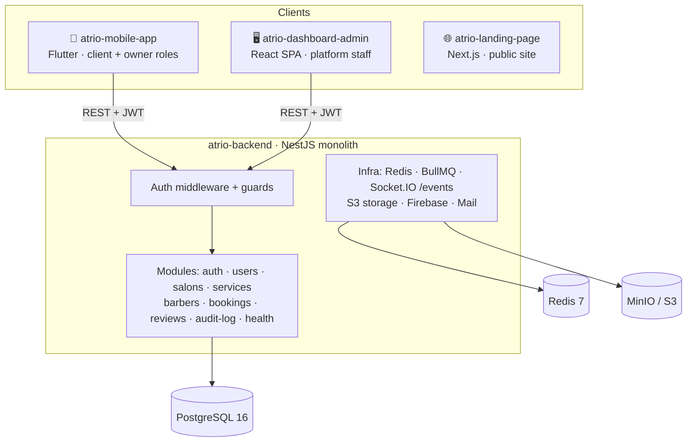
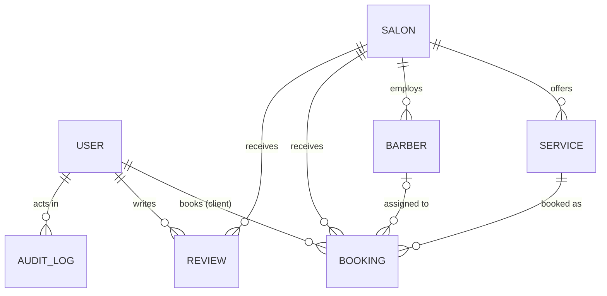
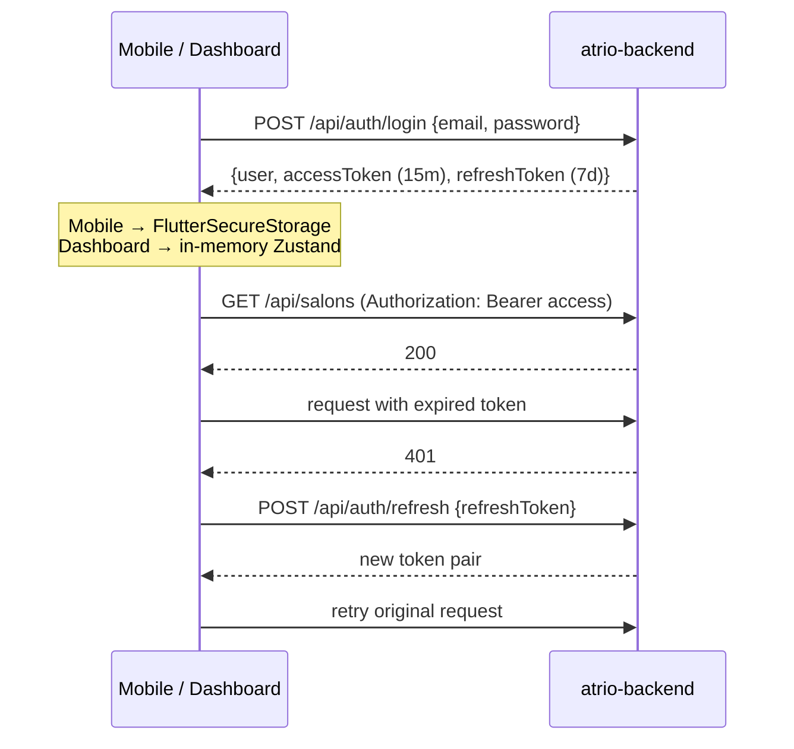

# Architecture

This page explains how the four Atrio projects are built and how they fit together. For setup and commands, see the [root README](../README.md).

- [System overview](#system-overview)
- [Domain model & roles](#domain-model--roles)
- [Backend (NestJS)](#backend-nestjs)
- [Mobile app (Flutter)](#mobile-app-flutter)
- [Admin dashboard (React)](#admin-dashboard-react)
- [Landing page (Next.js)](#landing-page-nextjs)
- [Authentication end to end](#authentication-end-to-end)
- [Design system](#design-system)
- [Integration status](#integration-status)

## System overview



The projects share no code. They connect only through the backend's HTTP contract, plus a shared design language and the conventions in [`CLAUDE.md`](../CLAUDE.md).

## Domain model & roles

Core entities in the backend (`src/modules/*/entities`):



Domain entities extend a shared `BaseEntity` with a UUID `id`, `createdAt` and `updatedAt`. The append-only audit log defines its own columns. Salons, services, barbers and reviews are soft-deleted (`deletedAt` + `isActive`). Users are deactivated (`isActive = false`).

**Roles** (`UserRole`): `SUPER_ADMIN` › `ADMIN` › `MANAGER` (salon owner) › `CASHIER` (front desk) › `CLIENT`. The mobile app models only two roles of its own, `client` and `owner`, which select the client or owner shell. How backend roles map onto them is not implemented yet. The endpoint-by-role matrix is in [API.md](API.md).

## Backend (NestJS)

```
src/
├── main.ts            # Helmet, CORS allow-list, ValidationPipe, exception filter, Swagger
├── app.module.ts      # Config, throttler, TypeORM, JWT, infra modules, feature modules
├── common/            # Cross-cutting infrastructure
│   ├── config/        # .env loader (Docker-aware), JWT config
│   ├── database/      # TypeORM config, BaseEntity, CLI data-source, migrations/
│   ├── middleware/    # AuthenticationMiddleware: decodes the Bearer JWT → req.user
│   ├── guards/        # AuthGuard (global), RolesGuard (@Roles)
│   ├── decorators/    # @Public, @Roles, @GetUser
│   ├── filters/       # GlobalExceptionFilter: uniform error envelope
│   ├── redis/ queues/ websockets/ storage/ firebase/ mail/
└── modules/           # One folder per domain: controller · service · dto/ · entities/
```

**Request pipeline:**

```
Request → Helmet/CORS → AuthenticationMiddleware (sets req.user from JWT)
        → ThrottlerGuard (10/s · 100/min · 1000/h)
        → AuthGuard (passes @Public, else requires req.user)
        → RolesGuard (only on routes with @Roles)
        → ValidationPipe (whitelist + forbidNonWhitelisted + transform)
        → Controller → Service → TypeORM repository
        → GlobalExceptionFilter (on error)
```

**Key decisions**

- **Modular monolith.** One deployable unit, with each domain isolated in its own Nest module. The `README` in `atrio-backend/` shows how to add a module.
- **Schema management.** TypeORM `synchronize` is on only when `NODE_ENV` is `development` or `test`. Production expects migrations (`yarn migration:generate` / `migration:run`). The `migrations/` folder is still empty.
- **Optional integrations.** Firebase starts only if credentials are present. Redis and Postgres support TLS for managed providers (`*_SSL_REJECT_UNAUTHORIZED`, `DB_CA_CERT`).
- **Real-time.** The `EventsGateway` on namespace `/events`, plus a Redis bridge and a `ws-publisher` service, lets any module push events across instances. No domain events are published yet.

## Mobile app (Flutter)

The app follows **Clean Architecture per feature** and wires everything with **Riverpod code generation**.

```
lib/
├── main.dart · bootstrap.dart · app.dart
├── core/
│   ├── network/     # DioClient + interceptors: Logging → Auth (QueuedInterceptor, refresh on 401) → Error
│   ├── router/      # GoRouter, StatefulShellRoute ×2 (client / owner), global redirect
│   ├── database/    # Drift (SQLite) database, tables, DAOs
│   ├── sync/        # SyncEngine, SyncConfig (5 retries, exponential backoff), status
│   ├── error/       # Exceptions (data layer) → Failures (domain layer)
│   ├── usecase/     # UseCase<T, Params> → Future<Either<Failure, T>>
│   ├── theme/       # Material 3 tokens, light/dark, ThemeModeNotifier
│   ├── storage/     # SecureStorage (tokens, profile) · LocalStorage (flags)
│   └── widgets/     # 50+ shared widgets (buttons, inputs, cards, states, layout)
└── features/<name>/
    ├── domain/        # entities · repository interfaces · use cases
    ├── data/          # @freezed models (toEntity) · datasources · repository impls
    └── presentation/  # pages · widgets · Riverpod notifiers · @freezed state unions
```

**Data flow**

```
Page ──watch──▶ Notifier ──▶ UseCase ──▶ Repository ──▶ DataSource (Dio / Drift / Storage)
  ▲                                         │
  └──── state (freezed union) ◀── Either<Failure, T> ◀── catches exceptions, checks connectivity
```

**Navigation.** GoRouter bridges auth state from Riverpod through a `ValueNotifier`. Its global `redirect`:

1. never redirects away from the splash screen, and waits while auth is initializing;
2. sends unauthenticated users on protected routes to **login**, or to **onboarding** on first launch;
3. sends newly authenticated users without a completed profile to **profile setup / choose role**;
4. sends returning users to the **owner dashboard** or **discover**, depending on role.

**Offline-first sync.** Writes go to Drift first and add an entry to a `SyncQueue` table. The `SyncEngine` drains that queue when connectivity returns, using exponential backoff. On `409` the server wins. The `notes` feature is the reference implementation, and the full walkthrough is in [`atrio-mobile-app/docs/offline_sync.md`](../atrio-mobile-app/docs/offline_sync.md).

**Environment & mocks.** `.env` is bundled as an asset through `flutter_dotenv`. `USE_MOCK_AUTH` swaps in `MockAuthRemoteDataSource`, but only when `!kReleaseMode`. The booking, salon, queue, owner and notification features currently have only mock datasources.

More detail: [`atrio-mobile-app/CLAUDE.md`](../atrio-mobile-app/CLAUDE.md) and [`atrio-mobile-app/README.md`](../atrio-mobile-app/README.md).

## Admin dashboard (React)

```
src/
├── main.tsx          # QueryClient (central 401/403/500 handling), router, providers
├── routes/           # TanStack Router file routes → routeTree.gen.ts (generated)
│   ├── _authenticated/   # beforeLoad guard + sidebar shell
│   ├── (auth)/           # sign-in, sign-up, forgot-password, otp
│   └── (errors)/         # 401, 403, 404, 500, 503
├── api/              # axios instance (JWT expiry check, CSRF header, HTTPS-only in prod), ENDPOINTS
├── stores/           # Zustand authStore (in-memory token + 15-min idle timeout)
├── features/         # Self-contained feature folders (components, data, context)
├── components/       # layout/ (sidebar, header), ui/ (shadcn), motion/ (Framer Motion)
├── context/          # theme, font, search (command palette)
└── i18n/             # i18next (en, fr)
```

- **Routing.** File-based, with automatic code splitting and `defaultPreload: 'intent'`. The router receives the `queryClient` through context so loaders can use it.
- **Server state.** TanStack Query. A global error handler clears auth and redirects to `/sign-in` on 401, and navigates to `/500` on 500.
- **Feature dialogs.** Each feature has a React context plus a `useDialogState` hook (for example, `UsersContext`).
- **Data today.** Users and tasks come from static/faker data. Bookings, clients and loyalty show KPI cards and empty states.

More detail: [`atrio-dashboard-admin/README.md`](../atrio-dashboard-admin/README.md).

## Landing page (Next.js)

- **App Router** with a `[locale]` segment, and `next-intl` middleware in `proxy.ts` (French by default, English). All copy lives in `messages/{fr,en}.json`.
- **Pages:** clients (`/`), salon owners (`/salons`), privacy notice (`/legal`), plus `sitemap.ts`, `robots.ts`, `manifest.ts` and JSON-LD.
- **Product visuals are coded React recreations** of the mobile app's screens (`app/components/screens/`), not screenshots, so they follow the theme and locale.
- No API dependency. Store links and the support email are configured in `app/lib/constants.ts`.

More detail: [`atrio-landing-page/README.md`](../atrio-landing-page/README.md).

## Authentication end to end



The mobile `AuthInterceptor` is a `QueuedInterceptor`, so concurrent 401s trigger a single refresh. The dashboard decodes `exp` before each request instead of waiting for a 401, and it signs the user out after 15 minutes of inactivity.

> As of today, the dashboard's sign-in is a demo stub, and the mobile app calls `/auth/refresh-token` rather than `/auth/refresh`. See [Integration status](#integration-status).

## Design system

All UI shares the **"Modern Griot / Editorial Artisan"** language:

| Rule | Implementation |
| --- | --- |
| No 1px borders | Boundaries come from tonal surface shifts (`surface` → `surface-container-low` → `-lowest`) and spacing |
| Ambient shadows only | `0 12px 32px rgba(25, 28, 30, 0.06)`, never pure black |
| Radius | 12px for buttons and cards, pill for chips |
| Color | Deep teal primary (`#00685F`) reserved for key CTAs; hero CTAs use a primary → primary-container gradient |
| Type | Inter; headlines at −0.02em tracking |
| Floating nav | Glassmorphism: surface at 80% + 20px backdrop blur |

Spec: [`atrio-mobile-app/ressources/precision_groom/DESIGN.md`](../atrio-mobile-app/ressources/precision_groom/DESIGN.md). Tokens live in `lib/core/theme/` (mobile), `src/index.css` (dashboard) and `app/globals.css` (landing).

## Integration status

| Capability | Backend | Mobile | Dashboard |
| --- | --- | --- | --- |
| Email/password auth | ✅ | ✅ real datasource (mock optional in debug) | ⚠️ demo stub |
| Token refresh | ✅ `/auth/refresh` | ⚠️ calls `/auth/refresh-token` | ✅ expiry check (no refresh call yet) |
| Phone/OTP auth, logout, `/auth/me` | ❌ | UI + endpoints defined | UI only |
| Salons, services, barbers | ✅ | mock data | — |
| Bookings | ✅ | mock data | empty state |
| Reviews | ✅ | mock data | — |
| Live queue | ❌ (gateway ready) | mock data | — |
| Loyalty, chat, notifications | ❌ | mock data | loyalty: empty state |
| Users admin | ✅ | — | static data |
| Audit log | ✅ | — | — |
